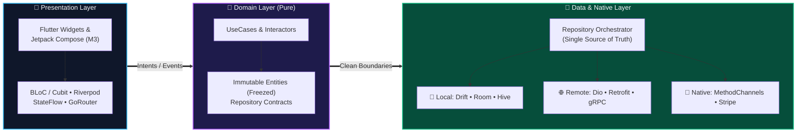
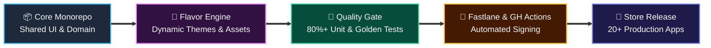
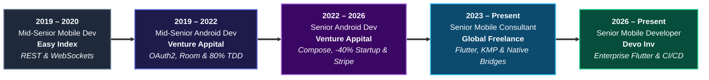

<div align="center">

  <h1>⚡ Ibrahem Mohamed Khalil</h1>
  <h3><b>Senior Mobile Architect & Principal Cross-Platform Engineer</b></h3>
  <p><i>Architecting Resilient Flutter & Native Android Ecosystems • Multi-Module Clean Architecture • White-Label CI/CD</i></p>

  <p>
    
    
    
    
  </p>

</div>

---

## 🎯 Engineering Impact & Core Metrics

<div align="center">
<table>
  <tr>
    <td align="center" width="25%">
      <h3>🏆 8+ Years</h3>
      <p><b>Production Engineering</b><br/><i>Enterprise Flutter & Native Android</i></p>
    </td>
    <td align="center" width="25%">
      <h3>🏢 20+ Apps</h3>
      <p><b>White-Label Ecosystem</b><br/><i>Single-Engine Multi-Tenant CI/CD</i></p>
    </td>
    <td align="center" width="25%">
      <h3>⚡ -40% Startup</h3>
      <p><b>Performance Gains</b><br/><i>Baseline Profiles & Compose Opt.</i></p>
    </td>
    <td align="center" width="25%">
      <h3>🛡️ 80%+ Coverage</h3>
      <p><b>Automated Quality</b><br/><i>Unit, Widget, MockK & Golden Tests</i></p>
    </td>
  </tr>
</table>
</div>

```yaml
# ─── Principal Engineering Specification ──────────────────────────────────────
engineer: "Ibrahem Mohamed Khalil"
current_roles:
  - "Senior Mobile Developer @ Devo Inv (Jan 2026 – Present)"
  - "Senior Cross-Platform Consultant @ Freelance (Jan 2023 – Present)"
education: "B.Sc. in Management Information Systems — Alexandria University"

architectural_pillars:
  cross_platform_native: ["Flutter (Dart)", "Native Android (Kotlin/Java)", "Jetpack Compose", "KMP"]
  state_and_patterns:    ["Clean Architecture", "Multi-Module", "BLoC / Cubit", "Riverpod", "MVI / MVVM"]
  offline_first_data:    ["Drift (SQLite)", "Room Database", "Hive / Isar", "Encrypted Shared Storage"]
  enterprise_security:   ["OAuth2 / JWT", "SSL/TLS Certificate Pinning", "Stripe Billing SDK", "MethodChannels"]
  release_automation:    ["GitHub Actions", "Fastlane Flavors", "Google Play Console", "App Store Connect"]
```

---

## 🏛️ System Architecture & CI/CD Blueprints

### 1. Clean Architecture & Offline-First Data Flow
Every application is engineered with strict **Unidirectional Data Flow (UDF)**, complete domain isolation, and **Offline-First** persistence to guarantee 100% data integrity under unstable network conditions.



### 2. Multi-Tenant White-Label Release Factory
Automated single-engine pipeline capable of branding, testing, signing, and deploying **20+ commercial fitness studio apps** simultaneously:



---

## 🛠️ Production Technology Matrix

<table>
  <tr>
    <td width="50%" valign="top">
      <h4>📱 Cross-Platform & Native UI</h4>
      <p>
        
        
        
        
        
        
        
        
      </p>
    </td>
    <td width="50%" valign="top">
      <h4>🏛️ Architecture, State & DI</h4>
      <p>
        
        
        
        
        
        
        
        
      </p>
    </td>
  </tr>
  <tr>
    <td width="50%" valign="top">
      <h4>🌐 Networking, Persistence & Bridges</h4>
      <p>
        
        
        
        
        
        
        
      </p>
    </td>
    <td width="50%" valign="top">
      <h4>🚀 DevOps, Cloud, Billing & QA</h4>
      <p>
        
        
        
        
        
        
        
      </p>
    </td>
  </tr>
</table>

---

## 🏆 Flagship Architectural Case Studies

<table>
  <tr>
    <td width="33%" valign="top">
      <h3>🏋️‍♂️ ClassFit & ClassFit Business</h3>
      <p>
        
        
      </p>
      <ul>
        <li>Spearheaded mobile engineering for a global fitness & studio management platform serving <b>thousands of daily active users</b>.</li>
        <li>Engineered real-time class booking engines, calendar sync, and <b>Stripe SDK</b> tokenized recurring subscriptions.</li>
        <li>Architected an <b>offline-first Room & encrypted persistence layer</b> guaranteeing zero data loss during live studio check-ins.</li>
      </ul>
    </td>
    <td width="33%" valign="top">
      <h3>🏭 20+ White-Label Studio Suite</h3>
      <p>
        
        
      </p>
      <ul>
        <li>Architected a single-engine multi-tenant ecosystem powering <b>20+ commercial brands</b> (<i>Wright Way, Elucidate, Sculpt Club, Peak Pilates, LV Fitness</i>).</li>
        <li>Built dynamic runtime theming, automated asset injection, and parameterized <b>Fastlane CI/CD</b> build flavors.</li>
        <li>Slashed multi-brand release overhead from days to minutes across Android & iOS.</li>
      </ul>
    </td>
    <td width="33%" valign="top">
      <h3>🎬 Eleven EdTech Streaming</h3>
      <p>
        
        
      </p>
      <ul>
        <li>Built responsive cross-platform interfaces and custom low-latency media playback pipelines for structured video curricula.</li>
        <li>Engineered background caching and encrypted chunk storage enabling uninterrupted <b>offline video learning</b>.</li>
        <li>Optimized memory management and frame rendering for smooth playback across low-end devices.</li>
      </ul>
    </td>
  </tr>
</table>

---

## 📈 Career Progression



---

## 📊 GitHub Engineering Telemetry

<div align="center">
  
</div>

<div align="center">
  
  
  
</div>

---

<div align="center">
  <h3>🤝 Let's Connect & Architect Scalable Mobile Products</h3>
  <p><i>Available for Senior / Principal Mobile Architecture, Enterprise Flutter & Native Android Leadership</i></p>
  <p>
    <a href="https://www.linkedin.com/in/ibrahem-khaleel-b0a137145">
      
    </a>
    <a href="mailto:ibrahemkhalil205@gmail.com">
      
    </a>
    <a href="https://github.com/ibrahemk">
      
    </a>
    <a href="#">
      
    </a>
  </p>
</div>
