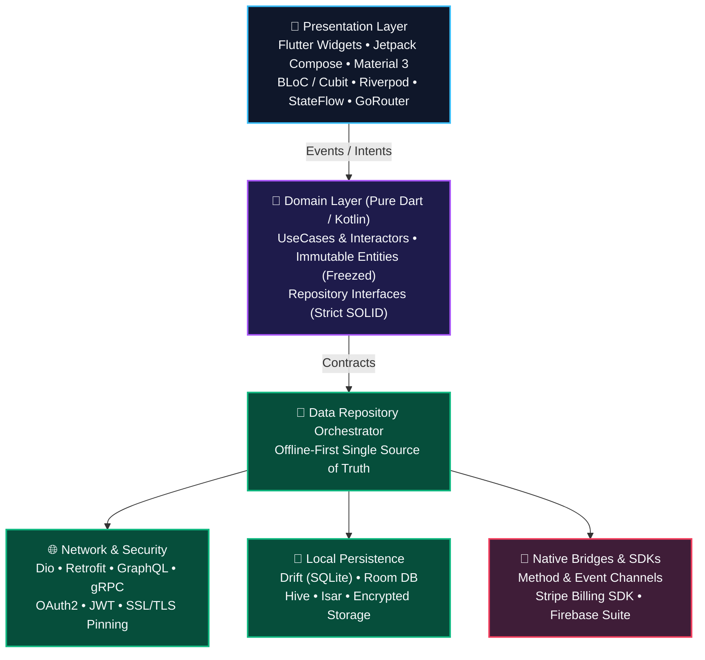
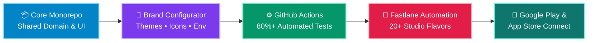

<div align="center">

# Ibrahem Khalil
### **Senior Mobile Architect & Principal Cross-Platform Engineer**
*Flutter • Native Android (Kotlin / Jetpack Compose) • Multi-Module Clean Architecture • White-Label CI/CD*

<br/>

[](https://www.linkedin.com/in/ibrahem-khaleel-b0a137145)
[](mailto:ibrahemkhalil205@gmail.com)
[](https://github.com/ibrahemk)

</div>

---

## ⚡ Executive Engineering Profile

```yaml
name: "Ibrahem Mohamed Khalil"
role: "Senior Mobile Developer @ Devo Inv & Principal Mobile Consultant"
experience: "8+ Years (Production Android & Flutter Ecosystems)"
education: "B.Sc. in Management Information Systems — Alexandria University"

core_competencies:
  - Cross-Platform & Native: ["Flutter (Dart)", "Android Native (Kotlin/Java)", "Jetpack Compose", "KMP"]
  - System Architecture:     ["Clean Architecture", "Multi-Module", "MVI / MVVM", "BLoC / Cubit", "Riverpod"]
  - Data & Persistence:      ["Offline-First Sync", "Drift (SQLite)", "Room DB", "Hive / Isar", "Encrypted Storage"]
  - Enterprise & FinTech:    ["Stripe SDK", "OAuth2 / JWT", "SSL/TLS Certificate Pinning", "Method/Event Channels"]
  - Release Engineering:     ["Multi-Tenant White-Labeling", "Fastlane", "GitHub Actions", "80%+ Automated QA"]
```

| 🏆 **8+ Years** | 🏢 **20+ Studio Brands** | 🚀 **-40% Cold Start** | 🛡️ **80%+ Test Coverage** |
| :---: | :---: | :---: | :---: |
| *Production Mobile Engineering* | *Single-Engine White-Label CI/CD* | *Baseline Profiles & Compose Opt.* | *JUnit5, MockK, Mocktail & Golden* |

---

## 🏛️ Production Architecture Blueprint

Every mobile platform I lead is built on strict **Clean Architecture**, **Unidirectional Data Flow (UDF)**, and **Offline-First** resilience—ensuring zero UI jank, complete domain isolation, and 100% data integrity under unstable network conditions.



---

## 🏭 Multi-Tenant White-Label Release Engine

Architected an automated single-engine factory capable of compiling, branding, signing, and deploying **20+ commercial fitness & wellness applications** simultaneously to **Google Play** and **App Store Connect**:



---

## 📈 Career Trajectory


---

## 🛠️ Technology Matrix

| Category | Production Technologies & Tooling |
| :--- | :--- |
| **📱 Languages & UI** |          |
| **🏛️ Architecture & State** |       |
| **💉 DI & Navigation** |      |
| **🌐 Networking & Data** |     -003B57?style=flat-square&logo=sqlite&logoColor=white)   |
| **🚀 DevOps, QA & SDKs** |       |

---

## 💼 Flagship Case Studies & Impact

| Project | Role | Key Architectural Highlights |
| :--- | :--- | :--- |
| **🏋️ ClassFit & ClassFit Business** | **Senior Android Developer** | • Spearheaded mobile development for an international fitness & studio management platform serving thousands of daily active users.<br/>• Engineered real-time class booking engines, calendar sync, and **Stripe SDK** recurring subscriptions.<br/>• Architected an **offline-first data layer** with reactive local persistence ensuring zero data loss during live studio check-ins. |
| **🏢 Multi-Tenant White-Label Ecosystem** | **Senior Android Developer** | • Engineered an automated white-label architecture powering **20+ commercial fitness studio apps** (*Wright Way Fitness, Elucidate Studio, The Sculpt Club Pilates, Peak Pilates, LV Fitness*, etc.).<br/>• Configured dynamic theming, environment-based asset injection, and parameterized **Fastlane CI/CD** build flavors for simultaneous Android & iOS releases. |
| **🎬 Eleven App (EdTech & Streaming)** | **Senior Mobile Engineer** | • Built responsive mobile interfaces and low-latency media playback pipelines delivering structured video curricula.<br/>• Engineered custom offline caching pipelines for video lessons and course assets to support continuous offline learning. |

---

## 📊 GitHub Engineering Telemetry

<div align="center">
  
</div>

<div align="center">
  
  
</div>

<div align="center">
  
</div>

---

<div align="center">

### 🤝 Let's Architect Your Next Mobile Product
*Open to Senior / Staff Mobile Engineering roles, Architectural Consulting, and Enterprise Flutter/Android Projects.*

[](mailto:ibrahemkhalil205@gmail.com)
[](https://linkedin.com/in/ibrahem-khaleel)

</div>
