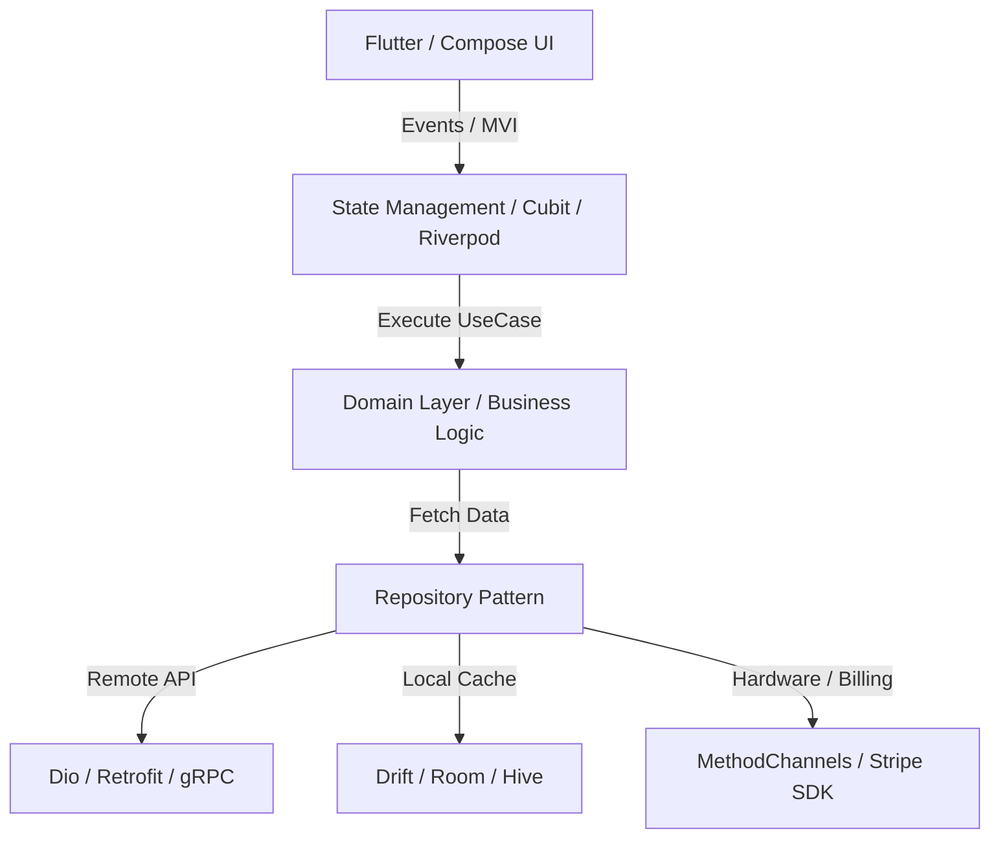
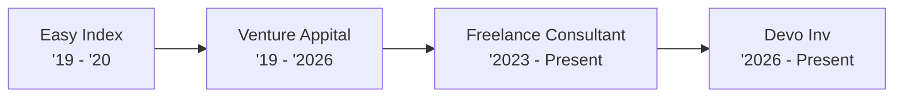

  

---

### 👨‍💻 About Me

Senior Mobile Developer with **8+ years** of engineering experience specializing in **Flutter (Dart)** and **Native Android (Kotlin/Java)** ecosystems. 

- 🔭 Currently contributing as a **Mobile Developer at Devo Inv** [cite: 1] & **Senior Cross-Platform Consultant** [cite: 1].
- 🏗️ Passionate about **Clean Architecture**, **Multi-Module Systems**, and reactive state management (**BLoC/Cubit, Riverpod, MVI/MVVM**).
- ⚡ Proven track record building **multi-tenant white-label ecosystems** (20+ commercial apps) [cite: 2], **offline-first data layers**, and seamless **Stripe payment** & **real-time media** pipelines [cite: 1, 2].
- 🧪 Strong advocate for **TDD**, automated testing (80%+ coverage), and **CI/CD automation** via GitHub Actions & Fastlane [cite: 1].

---

### 🏛️ System Architecture Blueprint
Below is the core architectural flow implemented across production applications, separating presentation, domain, and data layers with offline persistence and reactive state management:

---

### 📈 Career Progression

---

### 🛠️ Tech Stack & Tooling

#### 📱 Cross-Platform & Languages

  
  
  
  
  
  
  
  
  

#### 🏛️ Architecture, State & DI

  
  
  
  
  
  
  
  

#### 🌐 Networking, Persistence & Native Interop

  
  
  
  
  
  
  

#### 🚀 DevOps, Cloud, Payments & Testing

  
  
  
  
  
  
  

---

### 🏆 Featured Projects & Architectural Highlights

| Project | Role | Key Architectural Highlights |
| :--- | :--- | :--- |
| **ClassFit & ClassFit Business** | Senior Android Developer [cite: 2] | • International fitness & studio management platform serving thousands of daily users [cite: 2]. • Real-time class booking engines, calendar sync, and **Stripe SDK** recurring subscriptions [cite: 2]. • Offline-first reactive persistence ensuring zero data loss during live studio check-ins [cite: 2]. |
| **Multi-Tenant White-Label Ecosystem** | Senior Android Developer [cite: 2] | • Single-engine multi-brand architecture powering **20+ commercial fitness studio apps** (*Wright Way Fitness, Elucidate Studio, The Sculpt Club Pilates, Peak Pilates, LV Fitness, HappyHourFitness*, etc.) [cite: 2]. • Dynamic runtime theming, asset injection, and parameterized **Fastlane CI/CD** pipelines [cite: 2]. |
| **Eleven App (EdTech & Streaming)** | Senior Mobile Engineer [cite: 2] | • Interactive educational streaming platform delivering low-latency structured video curricula [cite: 2]. • Custom media playback & offline caching pipelines for uninterrupted learning [cite: 2]. |

---

### 📊 GitHub Analytics

  
  

  

---

  <b>Let's connect and build something scalable together!</b>  
  
  

