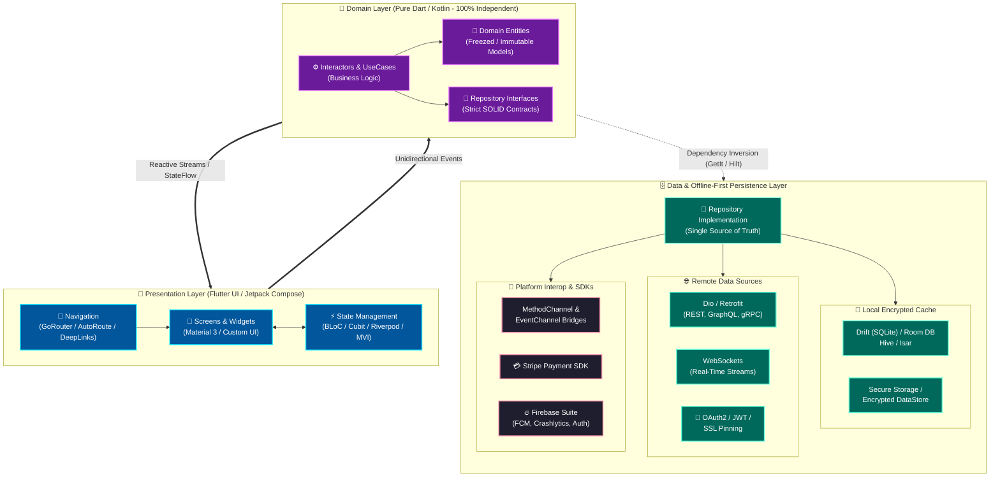
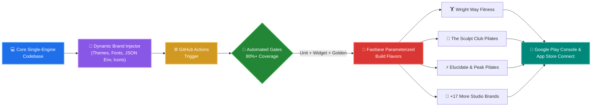
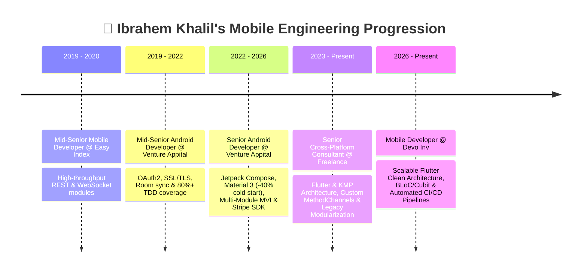

<!-- Animated Wave Header Banner -->

<!-- Animated Typing SVG -->

 

<!-- Vibrant Contact & Social Badges -->

## 🌈 Executive Summary

> **Senior Mobile Developer with 8+ years of engineering experience**, specializing in **Flutter (Dart)** and cross-platform ecosystems alongside deep **Native Android (Kotlin/Java)** roots. Currently architecting scalable multi-platform applications at **Devo Inv** and consulting globally. Proven track record in **Clean Architecture**, reactive state management (**BLoC/Cubit, Riverpod, MVI**), **20+ brand White-Label ecosystems**, **Stripe payment pipelines**, and **80%+ automated test coverage**.

| 🚀 **8+ Years** | 📱 **20+ White-Label Apps** | ⚡ **40% Faster Cold Start** | 🧪 **80%+ Test Coverage** |
| :---: | :---: | :---: | :---: |
| Production Mobile Engineering | Automated Multi-Tenant Releases | Baseline Profiles & Compose Opt | JUnit5, MockK, Mocktail & Golden |

## 🧭 System Architecture Blueprint (Flowchart)

Here is how I architect resilient, offline-first, multi-module **Flutter & Native Android** applications:

## 🏭 Multi-Tenant White-Label CI/CD Pipeline

How I engineered a single codebase to automatically build, theme, test, and deploy **20+ commercial fitness studio apps** simultaneously:

## 🛠️ Colorful Tech Stack Arsenal

### 📱 Cross-Platform & Core Languages

### 🏛️ Architecture, State Management & DI

### 🌐 Networking, Persistence & Native Bridges

### 🚀 DevOps, Payments, Security & QA

## 📈 Career Journey Flowchart

## 🏆 Flagship Architectural Case Studies

<table>
  <tr>
    <td width="33%" valign="top">
      <h3 align="center">🏋️‍♂️ ClassFit & ClassFit Business</h3>
      

        
        
      

      <ul>
        <li>Spearheaded mobile engineering for an international fitness & studio management platform serving thousands of daily users.</li>
        <li>Built real-time class booking engines, calendar sync, and <b>Stripe SDK</b> recurring subscriptions.</li>
        <li>Architected an <b>offline-first reactive persistence layer</b> guaranteeing zero data loss during live studio check-ins.</li>
      </ul>
    </td>
    <td width="33%" valign="top">
      <h3 align="center">🏢 20+ Brand White-Label Ecosystem</h3>
      

        
        
      

      <ul>
        <li>Engineered an automated multi-tenant architecture powering <b>20+ fitness brands</b> (<i>Wright Way Fitness, Elucidate Studio, The Sculpt Club Pilates, Peak Pilates, LV Fitness</i>, etc.).</li>
        <li>Configured dynamic runtime theming, environment asset injection, and parameterized <b>Fastlane CI/CD</b> build flavors for simultaneous Android & iOS releases.</li>
      </ul>
    </td>
    <td width="33%" valign="top">
      <h3 align="center">🎬 Eleven App (EdTech Streaming)</h3>
      

        
        
      

      <ul>
        <li>Built responsive cross-platform interfaces and custom media playback pipelines delivering low-latency structured video curricula.</li>
        <li>Engineered encrypted local video caching pipelines to enable seamless, continuous <b>offline learning</b>.</li>
      </ul>
    </td>
  </tr>
</table>

## 📊 Live GitHub Analytics & Activity

  
  

  

<!-- Animated Contribution Snake / Activity Graph -->

  

<!-- Animated Wave Footer -->

