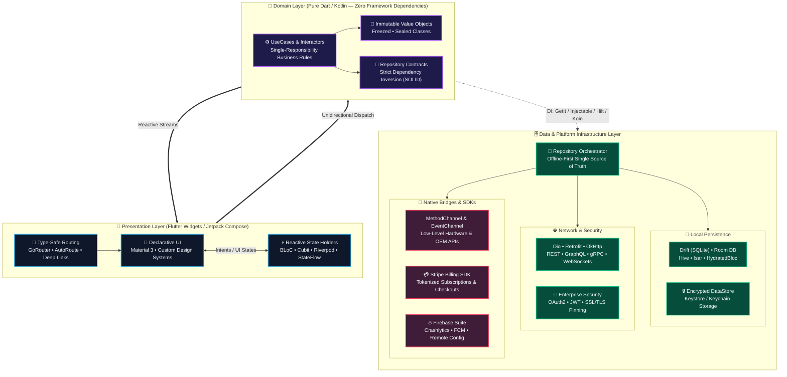
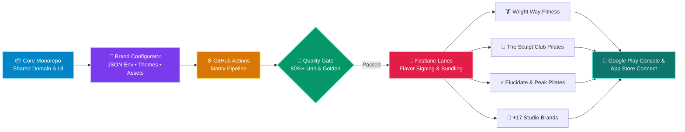
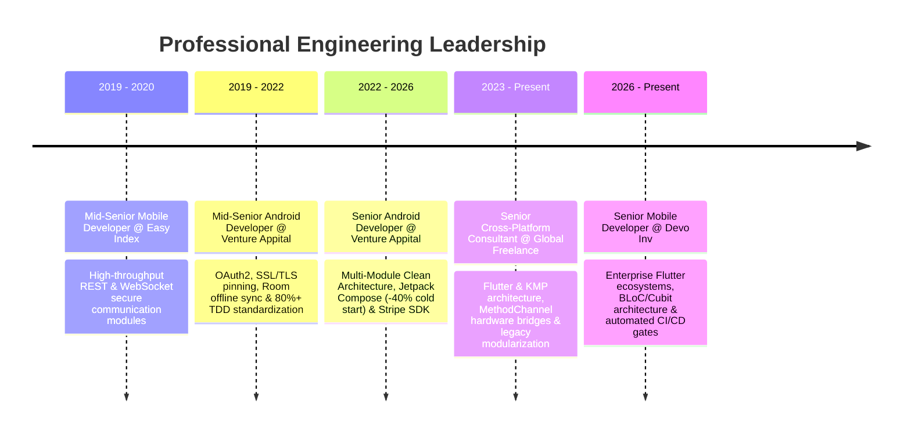

<div align="center">

# Ibrahem Khalil
### **Senior Mobile Architect & Principal Cross-Platform Engineer**
*Flutter • Native Android (Kotlin / Jetpack Compose) • Multi-Module Clean Architecture • White-Label CI/CD*

<br/>

[](https://www.linkedin.com/in/ibrahem-khaleel-b0a137145)
[](mailto:ibrahemkhalil205@gmail.com)
[](https://github.com/ibrahemk)


<br/>


</div>

---

## ⚡ Executive Engineering Profile

```yaml
name: "Ibrahem Mohamed Khalil"
role: "Senior Mobile Developer @ Devo Inv & Principal Mobile Consultant"
experience: "8+ Years (Production Android & Flutter Ecosystems)"
education: "B.Sc. in Management Information Systems — Alexandria University"

core_competencies:
  - Cross-Platform & Native: ["Flutter (Dart)", "Android Native (Kotlin/Java)", "Jetpack Compose", "KMP"]
  - System Architecture:     ["Clean Architecture", "Multi-Module", "MVI / MVVM", "BLoC / Cubit", "Riverpod"]
  - Data & Persistence:      ["Offline-First Sync", "Drift (SQLite)", "Room DB", "Hive / Isar", "Encrypted Storage"]
  - Enterprise & FinTech:    ["Stripe SDK", "OAuth2 / JWT", "SSL/TLS Certificate Pinning", "Method/Event Channels"]
  - Release Engineering:     ["Multi-Tenant White-Labeling", "Fastlane", "GitHub Actions", "80%+ Automated QA"]
```

<div align="center">

| 🏆 **8+ Years** | 🏢 **20+ Studio Brands** | 🚀 **-40% Cold Start** | 🛡️ **80%+ Test Coverage** |
| :---: | :---: | :---: | :---: |
| *Production Mobile Engineering* | *Single-Engine White-Label CI/CD* | *Baseline Profiles & Compose Opt.* | *JUnit5, MockK, Mocktail & Golden* |

</div>

---

## 🏛️ Production Architecture Blueprint

Every mobile platform I lead is built on strict **Clean Architecture**, **Unidirectional Data Flow (UDF)**, and **Offline-First** resilience—ensuring zero UI jank, complete domain isolation, and 100% data integrity under unstable network conditions.



---

## 🏭 Multi-Tenant White-Label Release Engine

Architected an automated single-engine factory capable of compiling, branding, signing, and deploying **20+ commercial fitness & wellness applications** simultaneously to **Google Play** and **App Store Connect**:



---

## 🛠️ Technology Matrix

| Domain | Production Technologies & Tooling |
| :--- | :--- |
| **📱 Languages & UI** |          |
| **🏛️ Architecture & State** |       |
| **💉 DI & Navigation** |       |
| **🌐 Networking & Data** |      -003B57?style=flat-square&logo=sqlite&logoColor=white)   |
| **🚀 DevOps, QA & SDKs** |       |

---

## 💼 Flagship Case Studies & Impact

<table>
  <tr>
    <td width="33%" valign="top">
      <h3>🏋️‍♂️ ClassFit & ClassFit Business</h3>
      <p>
        
        
      </p>
      <ul>
        <li>Spearheaded mobile engineering for an international studio management ecosystem serving thousands of daily active users.</li>
        <li>Built real-time class booking engines, two-way calendar sync, and <b>Stripe SDK</b> recurring subscriptions & tokenized checkouts.</li>
        <li>Engineered an offline-first reactive persistence layer ensuring <b>zero data loss</b> during live studio check-ins.</li>
      </ul>
    </td>
    <td width="33%" valign="top">
      <h3>🏢 20+ Brand White-Label Suite</h3>
      <p>
        
        
      </p>
      <ul>
        <li>Architected a single-engine multi-tenant ecosystem powering <b>20+ commercial fitness brands</b> (<i>Wright Way Fitness, Elucidate Studio, The Sculpt Club Pilates, Peak Pilates, LV Fitness</i>).</li>
        <li>Automated runtime theming, dynamic asset injection, and parameterized <b>Fastlane</b> build flavors for simultaneous Android & iOS releases.</li>
      </ul>
    </td>
    <td width="33%" valign="top">
      <h3>🎬 Eleven EdTech Streaming</h3>
      <p>
        
        
      </p>
      <ul>
        <li>Built responsive cross-platform interfaces and custom low-latency media playback pipelines for structured video curricula.</li>
        <li>Engineered encrypted background video caching pipelines enabling seamless offline learning across unstable networks.</li>
      </ul>
    </td>
  </tr>
</table>

---

## 📈 Career Trajectory



---

## 📊 GitHub Engineering Telemetry

<div align="center">
  
</div>

<div align="center">
  
  
  
</div>

<div align="center">
  
</div>

---

<div align="center">

### 🤝 Let's Architect Your Next Mobile Product
*Open to Senior / Staff Mobile Engineering roles, Architectural Consulting, and Enterprise Flutter/Android Projects.*

[](mailto:ibrahemkhalil205@gmail.com)
[](https://linkedin.com/in/ibrahem-khaleel)

</div>
