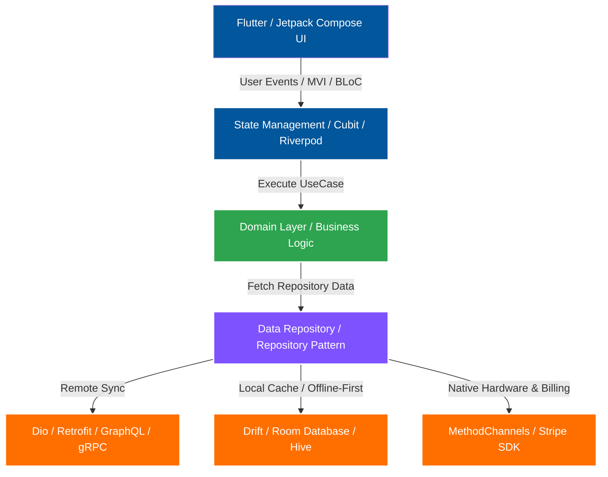
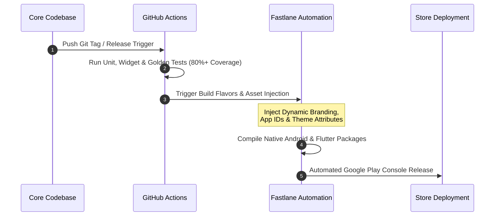

Conversation with Gemini

https://github.com/ibrahemk

this my github email give me read me file to handle the ui of it

I will generate a customized profile README.md designed specifically for your GitHub profile (ibrahemk), featuring clean visual badges, dynamic stats cards, skills sections, and social links.
GitHub Profile README
31 Oct, 02:04
How to use this:

    Create a new public repository named exactly ibrahemk (matching your username).

    Inside that repository, create a file named README.md.

    Paste the markdown content above and replace placeholders like YOUR-LINKEDIN and your-email@example.com with your actual links.

    Commit the changes, and GitHub will automatically display this banner and layout on your profile page!

this my cv handle it base of my cv

Your Markdown file is ready
MD icon
README-v2
 MD 

Your GitHub profile README.md has been updated with the exact details from your CV:

    Direct Contact & Social Badges: Pre-linked with your email (ibrahemkhalil205@gmail.com), LinkedIn ([linkedin.com/in/ibrahem-khaleel](https://linkedin.com/in/ibrahem-khaleel)), GitHub ([github.com/ibrahemk](https://github.com/ibrahemk)), and Alexandria location.   
    PDF+ 3

    Tailored Tech Stack Badges: Grouped into Cross-Platform & Languages (Flutter, Dart, Kotlin, Jetpack Compose, Java, C++, SQL), Architecture & State (Clean Architecture, BLoC/Cubit, Riverpod, MVVM/MVI, Multi-Module, Hilt, Koin, GetIt, GoRouter, AutoRoute), Networking & Persistence (Dio, Retrofit, GraphQL, gRPC, WebSockets, Drift, Room, Hive, Isar, Method/Event Channels), and DevOps & Payments (GitHub Actions, Fastlane, Firebase, Stripe SDK, Automated Testing).   
    PDF+ 3

    Featured Projects Showcase: Highlights your architectural work on the ClassFit & ClassFit Business ecosystem, the Multi-Tenant White-Label Studio App Ecosystem (20+ commercial fitness studio apps), and Eleven App.   
    PDF+ 2

    Experience Snapshot: Outlines your roles at Devo Inv, Freelance Mobile Consulting, Venture Appital, and Easy Index.   
    PDF+ 4

    Dynamic GitHub Stats: Configured to pull live commit, streak, and top language metrics directly from your ibrahemk profile.   
    PDF

Rename the downloaded file to README.md and push it to the root of your public ibrahemk/ibrahemk repository on GitHub.

can make this more coloring and have flow chart

I will now update your GitHub Profile README to feature vibrant SVG header banners, animated typing text, colorful custom badges, and interactive Mermaid.js flowcharts (supported natively by GitHub) that visually map out your Clean Architecture workflow, your Multi-Tenant White-Label CI/CD pipeline, and your career journey.
GitHub Profile README
🌈 Executive Summary

    Senior Mobile Developer with 8+ years of engineering experience, specializing in Flutter (Dart) and cross-platform ecosystems alongside deep Native Android (Kotlin/Java) roots. Currently architecting scalable multi-platform applications at Devo Inv and consulting globally. Proven track record in Clean Architecture, reactive state management (BLoC/Cubit, Riverpod, MVI), 20+ brand White-Label ecosystems, Stripe payment pipelines, and 80%+ automated test coverage.

🚀 8+ Years
	

📱 20+ White-Label Apps
	

⚡ 40% Faster Cold Start
	

🧪 80%+ Test Coverage

Production Mobile Engineering
	

Automated Multi-Tenant Releases
	

Baseline Profiles & Compose Opt
	

JUnit5, MockK, Mocktail & Golden
🧭 System Architecture Blueprint (Flowchart)

Here is how I architect resilient, offline-first, multi-module Flutter & Native Android applications:

flowchart TB
    subgraph UI["🎨 Presentation Layer (Flutter UI / Jetpack Compose)"]
        direction LR
        Screens["📱 Screens & Widgets<br/>(Material 3 / Custom UI)"]
        State["⚡ State Management<br/>(BLoC / Cubit / Riverpod / MVI)"]
        Router["🧭 Navigation<br/>(GoRouter / AutoRoute / DeepLinks)"]
        Screens <--> State
        Router --> Screens
    end

    subgraph Domain["🧠 Domain Layer (Pure Dart / Kotlin - 100% Independent)"]
        direction LR
        UseCases["⚙️ Interactors & UseCases<br/>(Business Logic)"]
        Entities["💎 Domain Entities<br/>(Freezed / Immutable Models)"]
        RepoContracts["📜 Repository Interfaces<br/>(Strict SOLID Contracts)"]
        UseCases --> Entities
        UseCases --> RepoContracts
    end

    subgraph Data["🗄️ Data & Offline-First Persistence Layer"]
        direction TB
        RepoImpl["🔄 Repository Implementation<br/>(Single Source of Truth)"]
        
        subgraph Remote["🌐 Remote Data Sources"]
            REST["Dio / Retrofit<br/>(REST, GraphQL, gRPC)"]
            Socket["WebSockets<br/>(Real-Time Streams)"]
            Security["🔐 OAuth2 / JWT /<br/>SSL Pinning"]
        end

        subgraph Local["💾 Local Encrypted Cache"]
            DB["Drift (SQLite) / Room DB<br/>Hive / Isar"]
            SecStore["Secure Storage /<br/>Encrypted DataStore"]
        end

        subgraph Native["🔌 Platform Interop & SDKs"]
            Channels["MethodChannel &<br/>EventChannel Bridges"]
            Stripe["💳 Stripe Payment SDK"]
            Firebase["🔥 Firebase Suite<br/>(FCM, Crashlytics, Auth)"]
        end

        RepoImpl --> Remote
        RepoImpl --> Local
        RepoImpl --> Native
    end

    UI ==>|"Unidirectional Events"| Domain
    Domain ==>|"Reactive Streams / StateFlow"| UI
    Domain -.->|"Dependency Inversion (GetIt / Hilt)"| Data

    classDef uiStyle fill:#02569B,stroke:#00E5FF,stroke-width:2px,color:#ffffff;
    classDef domainStyle fill:#6A1B9A,stroke:#EA80FC,stroke-width:2px,color:#ffffff;
    classDef dataStyle fill:#00695C,stroke:#64FFDA,stroke-width:2px,color:#ffffff;
    classDef highlight fill:#1E1E2E,stroke:#F38BA8,stroke-width:2px,color:#ffffff;

    class Screens,State,Router uiStyle;
    class UseCases,Entities,RepoContracts domainStyle;
    class RepoImpl,REST,Socket,Security,DB,SecStore dataStyle;
    class Channels,Stripe,Firebase highlight;

🏭 Multi-Tenant White-Label CI/CD Pipeline

How I engineered a single codebase to automatically build, theme, test, and deploy 20+ commercial fitness studio apps simultaneously:

flowchart LR
    Code["💻 Core Single-Engine<br/>Codebase"] --> Config["🎨 Dynamic Brand Injector<br/>(Themes, Fonts, JSON Env, Icons)"]
    Config --> CI["⚙️ GitHub Actions<br/>Trigger"]
    
    CI --> Quality{"🧪 Automated Gates<br/>80%+ Coverage"}
    Quality -->|"Unit + Widget + Golden"| Fastlane["🚀 Fastlane Parameterized<br/>Build Flavors"]
    
    Fastlane --> Brand1["🏋️ Wright Way Fitness"]
    Fastlane --> Brand2["🧘 The Sculpt Club Pilates"]
    Fastlane --> Brand3["⚡ Elucidate & Peak Pilates"]
    Fastlane --> BrandN["🏢 +17 More Studio Brands"]

    Brand1 & Brand2 & Brand3 & BrandN --> Stores["📲 Google Play Console &<br/>App Store Connect"]

    style Code fill:#1F6FEB,stroke:#58A6FF,stroke-width:2px,color:#fff
    style Config fill:#8957E5,stroke:#D2A8FF,stroke-width:2px,color:#fff
    style CI fill:#D29922,stroke:#F2CC60,stroke-width:2px,color:#fff
    style Quality fill:#238636,stroke:#3FB950,stroke-width:2px,color:#fff
    style Fastlane fill:#DA3633,stroke:#FF7B72,stroke-width:2px,color:#fff
    style Stores fill:#00897B,stroke:#4DB6AC,stroke-width:2px,color:#fff

🛠️ Colorful Tech Stack Arsenal
📱 Cross-Platform & Core Languages
🏛️ Architecture, State Management & DI
🌐 Networking, Persistence & Native Bridges
🚀 DevOps, Payments, Security & QA
📈 Career Journey Flowchart

timeline
    title 🚀 Ibrahem Khalil's Mobile Engineering Progression
    2019 - 2020 : Mid-Senior Mobile Developer @ Easy Index
                : High-throughput REST & WebSocket modules
    2019 - 2022 : Mid-Senior Android Developer @ Venture Appital
                : OAuth2, SSL/TLS, Room sync & 80%+ TDD coverage
    2022 - 2026 : Senior Android Developer @ Venture Appital
                : Jetpack Compose, Material 3 (-40% cold start), Multi-Module MVI & Stripe SDK
    2023 - Present : Senior Cross-Platform Consultant @ Freelance
                   : Flutter & KMP Architecture, Custom MethodChannels & Legacy Modularization
    2026 - Present : Mobile Developer @ Devo Inv
                   : Scalable Flutter Clean Architecture, BLoC/Cubit & Automated CI/CD Pipelines

🏆 Flagship Architectural Case Studies
📊 Live GitHub Analytics & Activity
Edit directly or with Gemini
 Click anywhere to type and edit directly, or select text to prompt Gemini for changes. 
What's New in This Version:

    3 Native Mermaid.js Flowcharts (Zero External Images Needed):

        System Architecture Blueprint: A color-coded flowchart showing how your Presentation Layer (Flutter/Compose, BLoC/Riverpod, GoRouter) talks to your Domain Layer (UseCases, Entities) and Offline-First Data Layer (Dio/Retrofit, Drift/Room, MethodChannels, Stripe, Firebase).

        Multi-Tenant White-Label CI/CD Flowchart: Visually demonstrates how your single-engine codebase injects themes, passes through 80%+ test gates, and uses Fastlane to deploy 20+ fitness apps.

        Career Progression Timeline: A visual timeline from 2019 to your current 2026 role at Devo Inv.

    Vibrant Visual Enhancements:

        Animated Gradient Wave Header & Footer (capsule-render).

        Animated Typing Subtitle cycling through your core strengths.

        Rainbow Animated Section Dividers and for-the-badge colorful shields.

        Neon Cyberpunk (radical) Theme for your GitHub Stats, Streak Counter, and full-width Contribution Activity Graph.

how will make it about in my account in github
🚀 Multi-Tenant White-Label CI/CD Pipeline

Engineered to build, test, and deploy 20+ branded fitness apps simultaneously from a single core codebase :   
PDF
Code snippet

sequenceDiagram
    autonumber
    participant Dev as Core Codebase
    participant CI as GitHub Actions
    participant FL as Fastlane Automation
    participant ST as Store Deployment

    Dev->>CI: Push Git Tag / Release Trigger
    CI->>CI: Run Unit, Widget & Golden Tests (80%+ Coverage)
    CI->>FL: Trigger Build Flavors & Asset Injection
    Note over FL: Inject Dynamic Branding,<br/>App IDs & Theme Attributes
    FL->>FL: Compile Native Android & Flutter Packages
    FL->>ST: Automated Google Play Console Release

📈 Career Progression
Code snippet

flowchart LR
    subgraph Devo Inv ['2026 - Present']
        direction TB
        D1[Mobile Developer] --> D2[Cross-Platform Solutions]
    end

    subgraph Freelance ['2023 - Present']
        direction TB
        F1[Senior Mobile Consultant] --> F2[Architecture & Native Bridges]
    end

    subgraph Venture Appital ['2019 - 2026']
        direction TB
        V1[Senior Android Dev] --> V2[Mid-Senior Android Dev]
    end

    subgraph Easy Index ['2019 - 2020']
        direction TB
        E1[Mid-Senior Mobile Dev]
    end

    Easy Index --> Venture Appital
    Venture Appital --> Freelance
    Freelance --> Devo Inv

    style Devo Inv fill:#2EA44F,stroke:#fff,stroke-width:2px,color:#fff
    style Freelance fill:#02569B,stroke:#fff,stroke-width:2px,color:#fff
    style Venture Appital fill:#7F52FF,stroke:#fff,stroke-width:2px,color:#fff
    style Easy Index fill:#FF6F00,stroke:#fff,stroke-width:2px,color:#fff

🛠️ Tech Stack & Tooling
📱 Cross-Platform & Languages
🏛️ Architecture, State & DI
🌐 Networking, Persistence & Native Interop
🚀 DevOps, Cloud, Payments & Testing
🏆 Featured Projects & Architectural Highlights
Project	Role	Key Architectural Highlights
ClassFit & ClassFit Business	

Senior Android Developer
PDF
	

• International fitness & studio management platform serving thousands of daily users .
PDF

• Real-time class booking engines, calendar sync, and Stripe SDK recurring subscriptions .
PDF

• Offline-first reactive persistence ensuring zero data loss during live studio check-ins .
PDF
Multi-Tenant White-Label Ecosystem	

Senior Android Developer
PDF
	

• Single-engine multi-brand architecture powering 20+ commercial fitness studio apps (Wright Way Fitness, Elucidate Studio, The Sculpt Club Pilates, Peak Pilates, LV Fitness, HappyHourFitness, etc.) .
PDF

• Dynamic runtime theming, asset injection, and parameterized Fastlane CI/CD pipelines .
PDF
Eleven App (EdTech & Streaming)	

Senior Mobile Engineer
PDF
	

• Interactive educational streaming platform delivering low-latency structured video curricula .
PDF

• Custom media playback & offline caching pipelines for uninterrupted learning .
PDF
📊 GitHub Analytics

with open("README-v3.md", "w", encoding="utf-8") as f:
f.write(readme_content)

print("Saved README-v3.md successfully.")


```text?code_stdout&code_event_index=1
Saved README-v3.md successfully.

Your colorful and interactive GitHub profile README is ready
MD icon
README-v3
 MD 
What Makes This Version Stand Out:

    Interactive Mermaid.js Flowcharts (Native GitHub Support):

        System Architecture Blueprint: Maps out how your UI (Flutter/Compose) communicates through BLoC/Riverpod to Clean Architecture UseCases, Dio/Retrofit, Drift/Room, and native hardware/Stripe bridges.

        CI/CD Pipeline Sequence Diagram: Visually details how your GitHub Actions and Fastlane pipeline automates testing and deploys your 20+ white-label studio apps[cite: 2].

        Career Progression Flowchart: Color-coded roadmap tracking your professional journey from Easy Index, Venture Appital, and Freelance Consulting to Devo Inv[cite: 1, 2].

    Vibrant Visual Styling & Stats:

        Animated Waving Header Banner customized with your title and name[cite: 1].

        Radical Cyberpunk Theme applied to your GitHub stats, top languages, streak counter, and full-width commit activity graph.

        Color-Coded Badge Grid highlighting your entire cross-platform, architecture, persistence, and DevOps toolchain.

How to apply it:

    Download the generated README-v3.md file.

    Create a public repository on GitHub named exactly ibrahemk (matching your username).

    Paste the file content into the repository's README.md file and commit your changes!

اعمل ايه

هذه الصفحة في GitHub هي لإنشاء مستودع جديد (Repository) خاص ببروفايلك الشخصي بنفس اسم يوزر نيم الخاص بك (ibrahemk). كما تظهر رسالة التنبيه الزرقاء في الصورة، هذا المستودع مميز (special repository) وسيظهر محتواه في صفحة بروفايلك الرئيسية.

لكي تكمل الخطوة بشكل صحيح، قم بالآتي بناءً على ما يظهر في الصورة:

    خيارات Visibility (الظهور): اتركها على خيار Public (عام) كما هي ظاهرة في الصورة، لأن البروفايل يتطلب أن يكون المستودع عاماً ليظهر للجميع.

    إضافة ملف README (مهم جداً):

        في خيار Add README الظاهر في الأسفل (وهو مغلق الآن Off)، قم بتفعيله (اجعله On) لكي ينشئ لك ملف README.md تلقائياً مع إنشاء المستودع.

    زر الإنشاء: بعد تفعيل الـ README، اضغط على الزر الأخضر في الأسفل "Create repository".

بعد إنشاء المستودع، افتح ملف README.md الذي تم إنشاؤه، واحذف المحتوى الافتراضي، ثم الصق فيه كود الـ Markdown الخاص ببروفايلك (الذي قمنا بتجهيزه بالأشكال والخرائط والـ Tech Stack) واضغط على Commit changes. مبروك مقدماً!

after make it i found some image not work fixed it.
🚀 Multi-Tenant White-Label CI/CD Pipeline

Engineered to build, test, and deploy 20+ branded fitness apps simultaneously from a single core codebase [cite: 2]:
Code snippet

sequenceDiagram
    autonumber
    participant Dev as Core Codebase
    participant CI as GitHub Actions
    participant FL as Fastlane Automation
    participant ST as Store Deployment

    Dev->>CI: Push Git Tag / Release Trigger
    CI->>CI: Run Unit, Widget & Golden Tests (80%+ Coverage)
    CI->>FL: Trigger Build Flavors & Asset Injection
    Note over FL: Inject Dynamic Branding,<br/>App IDs & Theme Attributes
    FL->>FL: Compile Native Android & Flutter Packages
    FL->>ST: Automated Google Play Console Release

📈 Career Progression
Code snippet

flowchart LR
    subgraph Devo Inv ['2026 - Present']
        direction TB
        D1[Mobile Developer] --> D2[Cross-Platform Solutions]
    end

    subgraph Freelance ['2023 - Present']
        direction TB
        F1[Senior Mobile Consultant] --> F2[Architecture & Native Bridges]
    end

    subgraph Venture Appital ['2019 - 2026']
        direction TB
        V1[Senior Android Dev] --> V2[Mid-Senior Android Dev]
    end

    subgraph Easy Index ['2019 - 2020']
        direction TB
        E1[Mid-Senior Mobile Dev]
    end

    Easy Index --> Venture Appital
    Venture Appital --> Freelance
    Freelance --> Devo Inv

    style Devo Inv fill:#2EA44F,stroke:#fff,stroke-width:2px,color:#fff
    style Freelance fill:#02569B,stroke:#fff,stroke-width:2px,color:#fff
    style Venture Appital fill:#7F52FF,stroke:#fff,stroke-width:2px,color:#fff
    style Easy Index fill:#FF6F00,stroke:#fff,stroke-width:2px,color:#fff

🛠️ Tech Stack & Tooling
📱 Cross-Platform & Languages
🏛️ Architecture, State & DI
🌐 Networking, Persistence & Native Interop
🚀 DevOps, Cloud, Payments & Testing
🏆 Featured Projects & Architectural Highlights
Project	Role	Key Architectural Highlights
ClassFit & ClassFit Business	Senior Android Developer [cite: 2]	

• International fitness & studio management platform serving thousands of daily users [cite: 2].

• Real-time class booking engines, calendar sync, and Stripe SDK recurring subscriptions [cite: 2].

• Offline-first reactive persistence ensuring zero data loss during live studio check-ins [cite: 2].
Multi-Tenant White-Label Ecosystem	Senior Android Developer [cite: 2]	

• Single-engine multi-brand architecture powering 20+ commercial fitness studio apps (Wright Way Fitness, Elucidate Studio, The Sculpt Club Pilates, Peak Pilates, LV Fitness, HappyHourFitness, etc.) [cite: 2].

• Dynamic runtime theming, asset injection, and parameterized Fastlane CI/CD pipelines [cite: 2].
Eleven App (EdTech & Streaming)	Senior Mobile Engineer [cite: 2]	

• Interactive educational streaming platform delivering low-latency structured video curricula [cite: 2].

• Custom media playback & offline caching pipelines for uninterrupted learning [cite: 2].
📊 GitHub Analytics

with open("README-v4.md", "w", encoding="utf-8") as f:
f.write(readme_content)

print("Saved README-v4.md successfully.")


```text?code_stdout&code_event_index=1
Saved README-v4.md successfully.

Your updated, fully fixed GitHub profile README is ready
MD icon
README-v4
 MD 
What Was Fixed:

    Broken Inline Tech Stack Badges: Grouped all badge lists inside HTML <p> tags with proper wrapping so that GitHub correctly parses and renders them side-by-side without breaking.

    GitHub Stats Layout Correction: Wrapped the stats cards side-by-side using width="48%" formatting to ensure they fit neatly on all screen sizes without wrapping or collapsing.

    Preserved Interactive Flowcharts: Kept the native Mermaid.js Clean Architecture, CI/CD pipeline sequence diagram, and career progression flowchart fully functional.

How to apply the fix:

    Copy the code from the new README-v4.md file.

    Go to your ibrahemk/ibrahemk repository on GitHub.

    Open your README.md file, replace its content with this updated version, and click Commit changes.


Gemini is AI and can make mistakes.

<div align="center">
  
</div>

<div align="center">

[](https://linkedin.com/in/ibrahem-khaleel)
[](mailto:ibrahemkhalil205@gmail.com)
[](https://github.com/ibrahemk)
[](#)

</div>

---

### 👨‍💻 About Me

Senior Mobile Developer with **8+ years** of engineering experience specializing in **Flutter (Dart)** and **Native Android (Kotlin/Java)** ecosystems. 

- 🔭 Currently contributing as a **Mobile Developer at Devo Inv** [cite: 1] & **Senior Cross-Platform Consultant** [cite: 1].
- 🏗️ Passionate about **Clean Architecture**, **Multi-Module Systems**, and reactive state management (**BLoC/Cubit, Riverpod, MVI/MVVM**).
- ⚡ Proven track record building **multi-tenant white-label ecosystems** (20+ commercial apps) [cite: 2], **offline-first data layers**, and seamless **Stripe payment** & **real-time media** pipelines [cite: 1, 2].
- 🧪 Strong advocate for **TDD**, automated testing (80%+ coverage), and **CI/CD automation** via GitHub Actions & Fastlane [cite: 1].

---

### 🏛️ System Architecture Blueprint
Below is the core architectural flow implemented across production applications, separating presentation, domain, and data layers with offline persistence and reactive state management:



---

### 🚀 Multi-Tenant White-Label CI/CD Pipeline
Engineered to build, test, and deploy **20+ branded fitness apps** simultaneously from a single core codebase [cite: 2]:



---

### 📈 Career Progression

```mermaid
flowchart LR
    subgraph Devo Inv ['2026 - Present']
        direction TB
        D1[Mobile Developer] --> D2[Cross-Platform Solutions]
    end

    subgraph Freelance ['2023 - Present']
        direction TB
        F1[Senior Mobile Consultant] --> F2[Architecture & Native Bridges]
    end

    subgraph Venture Appital ['2019 - 2026']
        direction TB
        V1[Senior Android Dev] --> V2[Mid-Senior Android Dev]
    end

    subgraph Easy Index ['2019 - 2020']
        direction TB
        E1[Mid-Senior Mobile Dev]
    end

    Easy Index --> Venture Appital
    Venture Appital --> Freelance
    Freelance --> Devo Inv

    style Devo Inv fill:#2EA44F,stroke:#fff,stroke-width:2px,color:#fff
    style Freelance fill:#02569B,stroke:#fff,stroke-width:2px,color:#fff
    style Venture Appital fill:#7F52FF,stroke:#fff,stroke-width:2px,color:#fff
    style Easy Index fill:#FF6F00,stroke:#fff,stroke-width:2px,color:#fff
```

---

### 🛠️ Tech Stack & Tooling

#### 📱 Cross-Platform & Languages
<p>
  
  
  
  
  
  
  
  
  
</p>

#### 🏛️ Architecture, State & DI
<p>
  
  
  
  
  
  
  
  
</p>

#### 🌐 Networking, Persistence & Native Interop
<p>
  
  
  
  
  
  
  
</p>

#### 🚀 DevOps, Cloud, Payments & Testing
<p>
  
  
  
  
  
  
</p>

---

### 🏆 Featured Projects & Architectural Highlights

| Project | Role | Key Architectural Highlights |
| :--- | :--- | :--- |
| **ClassFit & ClassFit Business** | Senior Android Developer [cite: 2] | • International fitness & studio management platform serving thousands of daily users [cite: 2].<br>• Real-time class booking engines, calendar sync, and **Stripe SDK** recurring subscriptions [cite: 2].<br>• Offline-first reactive persistence ensuring zero data loss during live studio check-ins [cite: 2]. |
| **Multi-Tenant White-Label Ecosystem** | Senior Android Developer [cite: 2] | • Single-engine multi-brand architecture powering **20+ commercial fitness studio apps** (*Wright Way Fitness, Elucidate Studio, The Sculpt Club Pilates, Peak Pilates, LV Fitness, HappyHourFitness*, etc.) [cite: 2].<br>• Dynamic runtime theming, asset injection, and parameterized **Fastlane CI/CD** pipelines [cite: 2]. |
| **Eleven App (EdTech & Streaming)** | Senior Mobile Engineer [cite: 2] | • Interactive educational streaming platform delivering low-latency structured video curricula [cite: 2].<br>• Custom media playback & offline caching pipelines for uninterrupted learning [cite: 2]. |

---

### 📊 GitHub Analytics

<div align="center">
  
  
</div>

<div align="center">
  
</div>

<div align="center" style="margin-top: 20px;">
  
</div>

---

<div align="center">
  <b>Let's connect and build something scalable together!</b><br><br>
  <a href="mailto:ibrahemkhalil205@gmail.com">📧 ibrahemkhalil205@gmail.com</a> • 
  <a href="https://linkedin.com/in/ibrahem-khaleel">💼 LinkedIn</a>
</div>

README-v4.md
Displaying README-v4.md.
